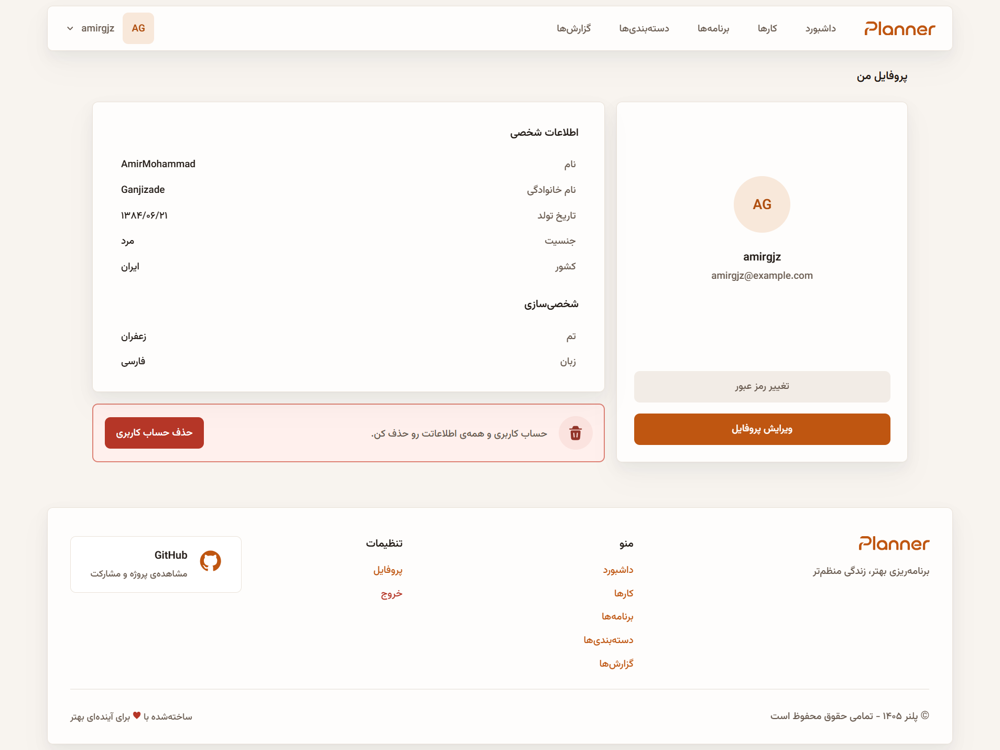
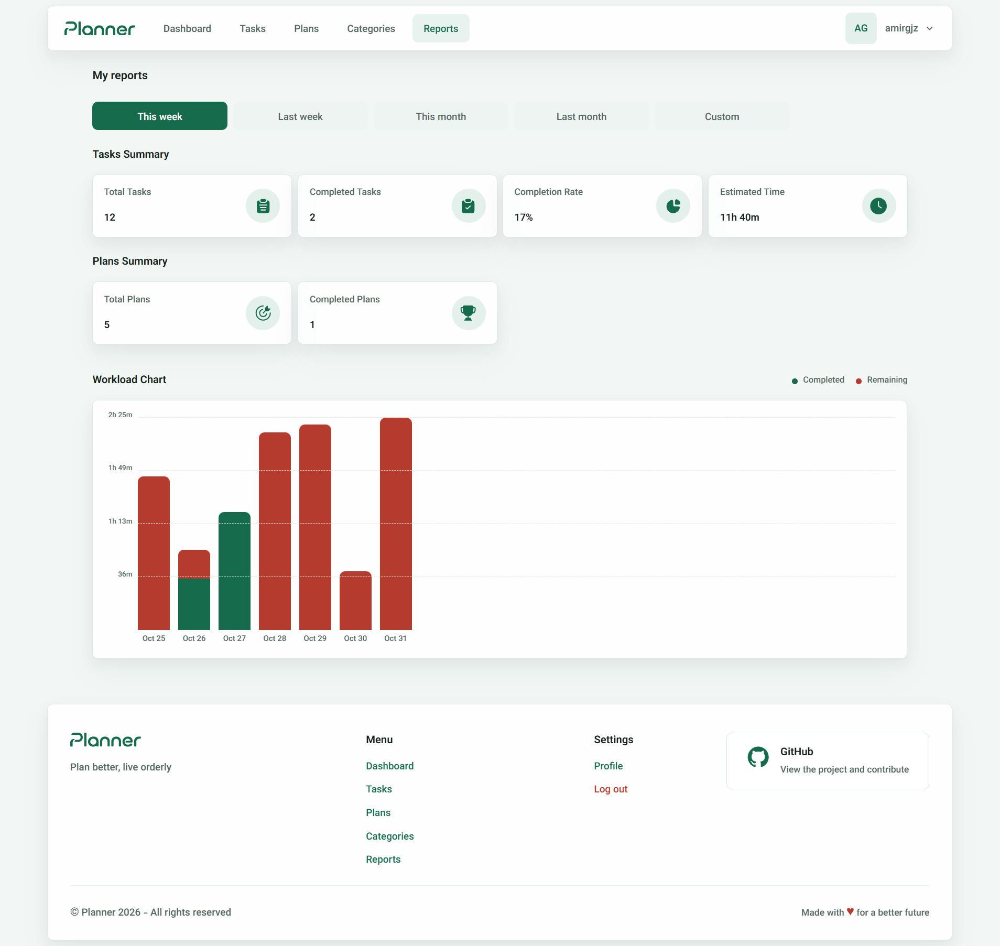

# 📋 Planner

A personal task planner that keeps you in control of your day. Assign each task to a day, group tasks into categories and plans, and see at a glance how much work every day actually carries — before you overbook yourself.

> Built with **Laravel 13**, **Livewire 4**, **Tailwind CSS 4**, **PHP 8.4**, **MariaDB 12**, and **Redis 8** — everything runs in Docker, so you don't need PHP or Node installed locally.

---

## 📸 Screenshots




---

## ✨ Features

- **Workload-aware days** — each day shows its total estimated time, color-coded Light → Very heavy, so a day's load is always one glance away.
- **Tasks needing attention** — overdue tasks and tasks whose alarm window has started surface on the dashboard with "due today / tomorrow / in X days" labels.
- **Categories & plans** — tasks belong to a category and optionally a plan; watch plan progress climb as you check tasks off.
- **Day & range views** — browse a single day or any custom date range, with search, combined filters, and sorting.
- **Performance reports** — completion rate, estimated time, plan totals, and a per-day workload chart for any period.
- **Persian & English** — switch anytime; Persian brings the Jalali calendar, Persian digits, and full RTL layout.
- **Color themes** — 8 swappable color themes (amber, chocolate, forest, gol-goli, magic, midnight, ocean, saffron) selectable from your profile.

---

# 🚀 Part 1: Using Planner (Production Setup Locally)

You only need **Docker with Docker Compose** (any recent version) and **Git** — nothing else touches your machine, the app runs entirely in containers. *(Note: `./planner` is a bash script; on Windows, run it via Git Bash or WSL).*

### 1. Set it up

**1. Clone the project**
```bash
git clone <your-repo-url> planner
cd planner
```

**2. Create your settings file**
```bash
cp laravel/.env.production laravel/.env
```

**3. Add the secrets** — open `laravel/.env` and fill in these values (leave everything else as-is). If any secret is missing, the start command stops immediately and tells you:
- `APP_KEY` — generate one with:
  ```bash
  printf 'base64:%s\n' "$(openssl rand -base64 32)"
  ```
- `DB_PASSWORD`, `MARIADB_ROOT_PASSWORD`, `REDIS_PASSWORD` — invent any secure passwords you like.

**4. Start it up**
```bash
./planner up
```
> [!TIP]
> The first run is slower than usual while Docker downloads base images and builds the app. Later starts are instantaneous.

### 2. Create Your Account & Log In

1. Open **http://localhost** in your browser.
2. Click **Register** and create an account.
3. The app will send an email verification link. Open **http://localhost:8025** (Mailpit) in another tab, click the verification email, and confirm your account.
4. Log in and start planning!

### 3. Make sure it's healthy

- `./planner ps` — every service (`php-fpm`, `queue`, `nginx`, `mariadb`, `redis`, `mailpit`) is `Up` / `running` / `healthy`.
- **http://localhost/up** returns `200`.

### Everyday Commands & Troubleshooting

| Command | What it does | When to use it |
|---|---|---|
| `./planner start` | Turns the app back on, right where it was | After pausing with `stop` |
| `./planner stop` | Pauses the app and frees system resources | Long breaks — starts back up fast |
| `./planner up` | Starts the app from the already-built version | A plain start, e.g. after `down` |
| `./planner down` | Stops everything and removes temporary containers | A clean slate; `up` brings it back |
| `./planner build && ./planner up` | Builds the newest code, then starts it | After every `git pull` update |
| `./planner logs` | Follows real-time container logs | Troubleshooting startup or runtime errors |

- Other devices on your local network can access the app too — use your computer's local IP instead of `localhost` (e.g. `http://192.168.1.20`).
- Your data is safe in Docker volumes — updating, restarting, or rebuilding never deletes it.
- **Updating:** `git pull` followed by `./planner build && ./planner up`.

> [!WARNING]
> Never run `./planner down -v` — the `-v` flag deletes your saved database and storage volumes.

---

# 🧑‍💻 Part 2: Developing This App

Development also runs in Docker — one container (`planner-workspace`) holds PHP 8.4, Composer, and Node. Your code lives in the normal project folder and is shared live with the container, so every file edit reflects instantly.

### 1. Set it up

**1. Clone & copy dev env:**
```bash
git clone <your-repo-url> planner
cd planner
cp laravel/.env.development laravel/.env
```

**2. Add secrets & start containers:**
Fill the same secrets (`APP_KEY`, `DB_PASSWORD`, `MARIADB_ROOT_PASSWORD`, `REDIS_PASSWORD`) in `laravel/.env`, then:
```bash
./planner-dev up
```

**3. Open a shell inside the container & install dependencies:**
```bash
./planner-dev shell
```
Inside the container terminal (at `/var/www`), run once:
```bash
composer install
npm install
```

**4. Optional — AI tooling setup** (inside the container shell):
```bash
php artisan boost:install
```
*This repo ships [Laravel Boost](https://laravel.com/docs/boost) as a dev dependency; run this if you use AI coding agents with the project. Skip it otherwise.*

**5. Optional — browser tests** (inside the container shell):
```bash
npx playwright install chromium
```
*Only needed if you run the opt-in `composer test:browser` suite — skip it otherwise. This downloads Chromium into a named Docker volume that survives restarts.*

### 2. Start developing

The easiest way — one command starts the app server (`artisan serve`), the queue listener, and Vite live-reload together:
```bash
composer run dev
```
Then open **http://localhost:8000**, register an account, and verify via Mailpit at **http://localhost:8025**.

### Day-to-Day Development

- **Edit & Refresh:** Modify code in `laravel/app/`, `laravel/resources/`, etc. — changes appear instantly.
- **Database changes:** Run `php artisan migrate` inside the container shell after pulling schema changes.
- **Seed demo data:** `php artisan db:seed --class=SampleDataSeeder` populates a screenshot-ready demo account with categories, plans, and tasks across 27 days.
- **Tests:** Run `composer test` (fast in-memory SQLite feature tests) or `composer test:browser` (opt-in Playwright browser suite).
- **Code Style:** Run `vendor/bin/pint --format agent` on modified PHP/Blade files before finishing.

### 📚 Internal Project Documentation & Conventions
This repository includes structured specifications, domain design, and strict architectural rules committed under `laravel/.ai/`:
- [Docs Map (`SKILL.md`)](laravel/.ai/skills/main-project/SKILL.md) — guide to phase documents, docker setups, and git workflow.
- [Project Rules Index](laravel/.ai/rules/index.md) — area-scoped architectural rules (actions, auth, models, tests, UI).
- [Coding Standards](laravel/.ai/skills/main-project/standards/coding.md) — cross-cutting rules and patterns for every change.
- [Deployment Guide](laravel/.ai/skills/main-project/deployment/guide.md) — VPS deployment runbook (hardened host, Cloudflare, TLS, mail, operations).
- [Project Guideline](laravel/.ai/guidelines/main-project.md) — core project rules and session guidelines.

### Dev Commands Table

| Command | What it does |
|---|---|
| `./planner-dev up` | Starts workspace, MariaDB, Redis, and Mailpit |
| `./planner-dev shell` | Opens an interactive bash terminal inside the workspace container |
| `./planner-dev down` | Stops dev containers |
| `composer run dev` | Starts server, queue, and Vite together |
| `php artisan test` | Runs the test suite |

> [!WARNING]
> Never run `./planner-dev down -v` — the `-v` deletes your dev database.

---

## 👤 Author

Made with ❤️ by [AmirMohammad Ganjizade](https://github.com/AmirGjzh)
